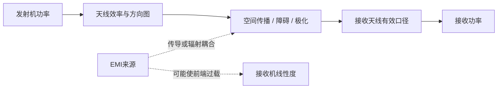

# 天线指标与电磁兼容

## 有效口径、方向性与增益

- **有效口径 $A_e$（effective aperture）**：接收天线从入射功率密度中有效取得功率的等效面积。理想匹配、同极化条件下，$P_r=S_{inc}A_e$；对天线增益 $G$，$A_e=G\lambda^2/(4\pi)$。实际接收功率还会受极化、方向、失配和效率影响。口径不是天线的物理面积。
- **方向性（directivity, $D$）**：辐射强度相对各方向平均值的比值，描述方向图把能量集中到某个方向的程度；常用 dBi 表示相对理想各向同性天线的峰值方向性。
- **天线增益（gain, $G$）**：方向性再计入天线辐射效率（具体规格还要看是否包括失配损耗）。因此高方向性不代表效率必然高；不能把 dBi 与 dBd 混用（两者参考天线不同）。
- **多样性（diversity）**：接收端利用不同天线/空间、频率、时间或极化分支所经历的衰落差异，进行选择或合并，以降低深衰落概率。它不等于简单地“多用几个信道”，也不能保证消除所有干扰。

### 增益是方向量

天线增益随观察方向变化，可写成 $G(\theta,\phi)$。规格表上单独标出的 dBi 数值通常是**峰值增益**，即方向图中增益最大的方向；它不一定是“垂直于天线”的方向。需要知道具体方向的增益时，应查看天线的方位面和俯仰面方向图。

- 对理想细直偶极子，最大辐射通常在**垂直于天线轴**的方向，沿天线轴方向则有零点。
- 对贴片天线，最大增益通常朝向垂直于贴片面的方向。
- 定向天线的最大增益方向由其结构决定，不能仅凭某根天线杆的朝向判断。

增益不是天线凭空增加总功率；它描述相对于各向同性参考天线，天线在某个方向上的辐射强度。天线把能量更多集中到某些方向时，其他方向通常会相对减弱。

天线增益与环境相关：方向图、安装、地平面、极化和近旁材料都会影响链路。做链路预算时可继续看 [[Friis Equation]]、[[EIRP & Power Density]] 和 [[Near Field & Far Field]]；理想偶极子的方向图见 [[ATU/isotropic antenna & dipole antenna]]。

## EMI 与 EMC

- **EMI（电磁干扰）**：非预期电磁能量对设备工作造成的影响；来源可以是同机数字时钟、电源、邻近无线设备或外部发射源。
- **EMC（电磁兼容）**：设备在预期电磁环境中能够正常工作，同时其发射不对其他设备造成不可接受干扰的能力。它同时涉及**抗扰度/抗干扰**和**发射控制**，不只是“没有 EMI”。

实际排查要区分传导与辐射、近场耦合与远场干扰，并记录干扰频率、带宽、强度、设备状态和线缆/天线布置。强带外信号即使不在接收信道内，也可能让 LNA/混频器过载或通过互调、LO 相位噪声降低灵敏度；参见 [[Linearity and RF Impairments]]。

### 来源

- 原始术语表：[[RF/rf-basics-guide.pdf#page=26]] 至 [[RF/rf-basics-guide.pdf#page=27]]。
- 术语说明为工程入门摘要；产品合规限值须按目标国家/地区的现行法规与对应测试标准核实，不能直接套用这份较早的 Maxim 指南中的历史限值。
