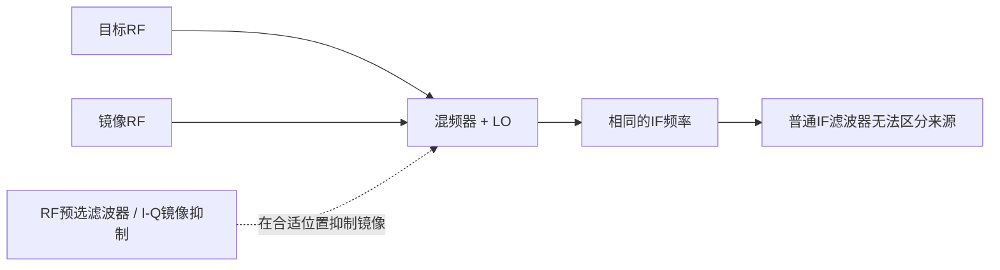
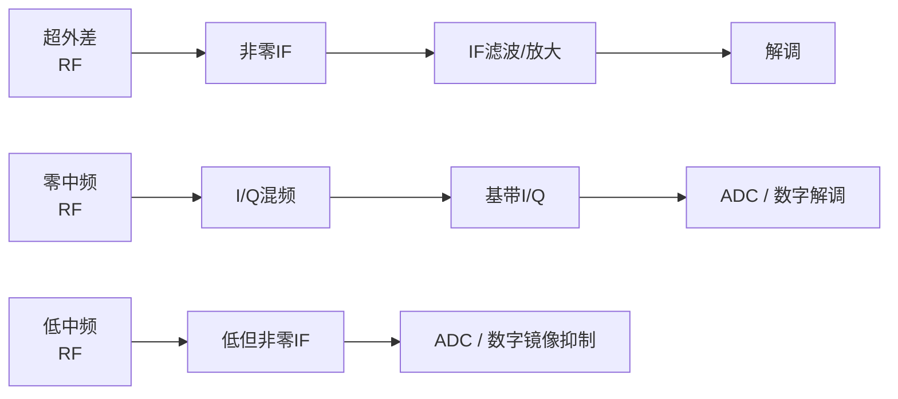

# 镜像频率与接收机频率规划

混频器将 RF 与 LO 相乘，输出包含和频、差频等分量；滤波器再选出所需分量。对常见超外差接收机：

$$
f_{IF}=|f_{RF}-f_{LO}|
$$

## 高侧与低侧注入、镜像频率

对于给定 LO 和 IF，LO 两侧相距 IF 的两个 RF 频率都会变到相同的 IF。一个是目标频率，另一个就是**镜像频率**。两者相距 $2f_{IF}$：

$$
f_{image}=f_{wanted}\pm 2f_{IF}
$$

符号取决于 LO 在目标信号哪一侧；更不易出错的做法是先写出 $f_{LO}=f_{wanted}\pm f_{IF}$，然后找 LO 另一侧相距 $f_{IF}$ 的频率。

**例：**目标 RF 为 2.4 GHz，LO 为 2.3 GHz，则 IF 为 100 MHz；LO 另一侧的 2.2 GHz 也会变成 100 MHz，因此是镜像。普通 IF 滤波器无法在变频后区分两者，通常要在混频前用 RF 预选滤波器抑制镜像，或使用 I/Q 镜像抑制架构。抑制度有限时用镜像抑制比（IRR）描述。

```text
RF频谱（示例）
2.2 GHz                  2.3 GHz                  2.4 GHz
镜像 ──距LO 100 MHz──→   LO   ──距LO 100 MHz──→   目标信号
   两者混频后都落在 |RF − LO| = 100 MHz IF
```



高侧注入是 $f_{LO}>f_{wanted}$，低侧注入是 $f_{LO}<f_{wanted}$。选哪一侧会影响镜像落点、滤波难度、频率规划及本振杂散；不是只看 IF 数值即可。

## 零中频与低中频

- **超外差**：将 RF 变到非零 IF，再滤波/放大；在低频 IF 实现窄带选择通常较容易，但要处理镜像。
- **零中频（Zero-IF / direct conversion）**：令 LO 接近目标载波，I/Q 混频后直接得到以 DC 为中心的复数基带。省去传统 IF 级，适合高度集成，但要处理 LO 泄漏与自混频产生的 DC offset、I/Q 增益/相位不平衡、低频 $1/f$ 噪声，以及 LO 与载波频偏。
- **低中频（Low-IF）**：目标落在较低但非零的 IF，可避开部分 DC offset 和 $1/f$ 噪声影响；仍须考虑镜像（常以数字 I/Q 滤波抑制），并在 ADC 采样率和滤波器设计间权衡。
- **单次变频（single conversion）**：接收链路只有一个 IF 变频级；多次变频则依次搬到不同 IF，以折衷镜像抑制、滤波选择性和实现复杂度。
- **PLL Lock Detect（锁定检测）**：PLL 给出的状态信号/寄存器位，用来指示频率合成环认为自己已锁定。它不保证天线口信号正常，也不代替检查频率精度、相位噪声或杂散。
- **晶体负载电容**：晶体振荡器电路需按数据手册提供晶体“看到”的等效负载电容；负载偏差会造成频率偏移。参见 [[Crystal Oscillator]]。



这些是常见架构而非严格的频率分界；“低 IF”不是“零 IF”的另一种叫法。I/Q 的坐标和调制含义参见 [[QAM]]；镜像抑制混频器的两路相位关系参见 [[Image Rejection Mixer]]。

### 来源

- 原始术语表：[[RF/rf-basics-guide.pdf#page=27]] 至 [[RF/rf-basics-guide.pdf#page=29]]、[[RF/rf-basics-guide.pdf#page=32]]。
- [Analog Devices：Image-Reject Mixer](https://www.analog.com/en/resources/app-notes/an-1258.html)
- [Analog Devices：Optimizing Performance in Wideband Direct-Conversion Receivers](https://www.analog.com/en/resources/design-notes/optimizing-performance-wideband-direct-conversion-receivers.html)
