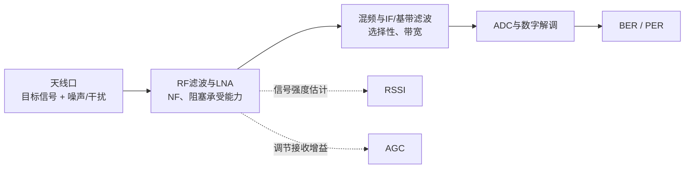

# 接收机性能指标

这些指标回答的是不同问题：接收机能处理多强的信号、能否从噪声中分辨信号，以及输出数据错了多少。规格只有在**频率、带宽、调制、数据率、误码判据和测试条件相同**时才适合直接比较。



*读规格时先确认测量点：灵敏度一般指天线口/接收机输入端满足指定 BER 或 PER 的功率，不是 RSSI 数字本身。*

## 热噪声、噪声系数与灵敏度

在约 290 K（室温）的匹配电阻上，热噪声功率谱密度约为 **−174 dBm/Hz**。接收带宽为 $B$ Hz 时，理想热噪声功率为：

$$
N_{kTB}\;(\mathrm{dBm}) \approx -174 + 10\log_{10}(B)
$$

实际接收机还会引入噪声。噪声因子和噪声系数定义为：

$$
F=\frac{\mathrm{SNR}_{in}}{\mathrm{SNR}_{out}},\qquad NF=10\log_{10}(F)\;\mathrm{dB}
$$

这里 $F$ 是线性功率比；噪声系数通常以输入、输出端具有相同参考温度（常用 290 K）为条件。**NF 越低，接收链路增加的噪声越少**。级联系统的首级噪声性能尤其重要：前级增益足够时，后级噪声的相对影响会减小。

灵敏度是满足指定解调质量时，接收机输入端所需的最小信号功率；单位常为 dBm，数值**越负通常越灵敏**。一个便于估算的下限是：

$$
P_{sens}\approx -174 + 10\log_{10}(B) + NF + SNR_{req} + L_{impl}\quad(\mathrm{dBm})
$$

$SNR_{req}$ 是目标调制/编码达到指定 BER 所需的信噪比，$L_{impl}$ 汇总实现损失及设计余量。例：20 MHz 带宽的热噪声约为 $-101$ dBm；若 NF 为 5 dB、所需 SNR 为 10 dB，粗略灵敏度约为 $-86$ dBm（尚未计实现损失）。实际规格以厂商规定的**带宽、包/比特误码判据、速率和封包条件**为准。

## 质量与强度读数

- **SNR（信噪比）**：有用信号功率与噪声功率之比，功率比用 dB 表示时为 $10\log_{10}(P_s/P_n)$。提高 SNR 通常有助解调，但干扰和失真也可能限制性能。
- **噪声类型**：热噪声来自电阻中载流子的热运动；散粒噪声与电荷离散通过势垒有关；闪烁噪声（$1/f$ noise，常称 pink noise）在低频更显著。理想白噪声模型的功率谱密度不随频率改变；天空噪声则是天线接收的环境/天体噪声，在卫星链路等场景会以天线噪声温度处理。
- **SINAD**：有用信号功率与噪声加失真功率之比，常用于模拟接收机或测试音测量。不要把信号、噪声、失真的总功率放在分子后仍称为 SINAD。
- **BER（误比特率）**：错误比特数除以比较的总比特数。灵敏度通常附带 BER 或 PER 门限；不同门限、编码和测试时长下的灵敏度不可直接类比。BER 测试仪常称 BERT。
- **RSSI（接收信号强度指示）**：芯片或接收机给出的强度估计，可能是寄存器值、电压或 dB 标度读数。未校准的 RSSI 不一定等于精确的天线口 dBm，也可能因频率、增益档位或芯片而异。
- **增益与单位**：增益是输入/输出功率的比值，通常用 dB；dBm 是相对 1 mW 的绝对功率电平。不能把“增益为 dBm”当作单位。
- **星座图**：把数字调制符号画在复数 I/Q 平面上；点云偏离理想位置可反映噪声、相位误差、增益误差等。参见 [[QAM]] 与 [[ATU/What is EVM]]。
- **DSP（数字信号处理）**：处理 ADC 产生的离散样本，例如数字滤波、同步、解调、误码检测/纠正；DSP 是一类处理功能，不一定是独立芯片。
- **Latency（时延）**：从接收 RF 信号到解码出基带数据所经历的时间（或系统定义的其他端到端延迟）。它是时序/系统指标，不等同于灵敏度或信号质量。

## 动态范围

动态范围指系统在规定性能条件下可处理的信号电平范围。接收机低端受灵敏度/噪声限制，高端则受压缩、互调、ADC 满量程等限制；强阻塞信号还可能在目标信号仍较弱时先让前端失去灵敏度。不要把灵敏度、$P_{1\mathrm{dB}}$、IP3 或无杂散动态范围（SFDR）当成同一个指标。

```text
过弱：低于灵敏度       可用接收范围                过强：压缩 / 互调 / ADC过载
───────────────|================================|──────────────────────>
```

## 自动增益控制（AGC）

AGC 根据接收信号强弱调整接收链路增益，使后级（例如 ADC）处于可用动态范围内。AGC 能避免过弱信号利用不足或强信号使后级过载，但它不会消除天线口已经存在的噪声或失真；分析接收功率时还要知道当前增益档位及 RSSI 的校准方式。

### 来源与延伸

- 原始术语表：[[RF/rf-basics-guide.pdf#page=26]]、[[RF/rf-basics-guide.pdf#page=29]]、[[RF/rf-basics-guide.pdf#page=31]]。
- [Keysight：Fundamentals of RF and Microwave Noise Figure Measurements](https://www.keysight.com/us/en/assets/7018-06808/application-notes/5989-9889.pdf)
